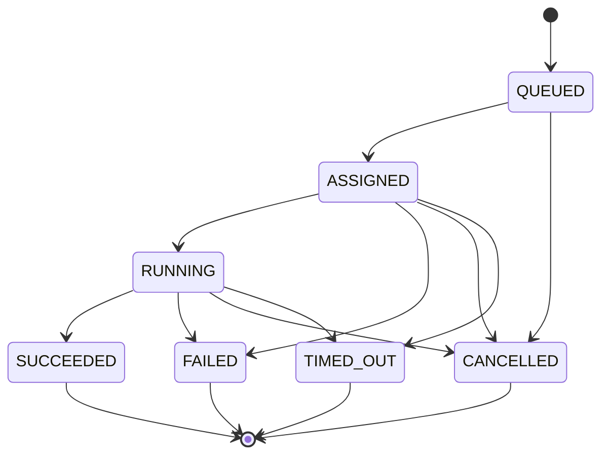

# 5.7 — машина состояний задачи AI Agent Engine

**Версия контракта:** 18.11.2026. Канонический enum и неизменяемый граф
переходов находятся в `ai_agent_engine/task_state.py`; это источник
значений, которыми будут пользоваться исполнитель и планировщик. Пункт
**5.8** добавил [проверку переходов и аудит](./TASK_TRANSITIONS.md).

## Состояния и жизненный цикл

| Значение `TaskState` | Значение в JSON | Смысл |
| --- | --- | --- |
| `QUEUED` | `queued` | Задача принята; исполнителя нет. Зависимости и приоритеты регулируют готовность к выбору. |
| `ASSIGNED` | `assigned` | За задачей неизменно закреплена пара worker + приватный каталог (5.6). |
| `RUNNING` | `running` | Доверенный исполнитель начал обработку; **пока не реализовано**. |
| `SUCCEEDED` | `succeeded` | Работа завершилась успехом; терминальное. |
| `FAILED` | `failed` | Обработка завершилась ошибкой; терминальное. |
| `CANCELLED` | `cancelled` | Контролируемая отмена; терминальное. |
| `TIMED_OUT` | `timed_out` | Превышено время выполнения; терминальное. |

`QUEUED` — начальное состояние. Отсутствие доступной предпосылки в DAG
не создаёт дополнительного состояния: задача остаётся `queued`, но
не выбирается планировщиком. `TERMINAL_STATES` — точный набор четырёх
конечных состояний, из которых нет исходящих переходов.

## Схема разрешённых переходов

| Из | В (только эти переходы) |
| --- | --- |
| `queued` | `assigned`, `cancelled` |
| `assigned` | `running`, `failed`, `cancelled`, `timed_out` |
| `running` | `succeeded`, `failed`, `cancelled`, `timed_out` |
| `succeeded`, `failed`, `cancelled`, `timed_out` | Нет |

Схема задана `MappingProxyType` и `frozenset`, не редактируется в ходе
запроса. `allowed_next_states(state)` и `can_transition(from_state,
to_state)` принимают только enum `TaskState`, а не произвольные строки.
В переходах нет неявных циклов, повторного `assigned` или скачка
`queued → succeeded`. **Перечисление разрешённого перехода — не выдача
клиенту права на него:** доверенные команды, ограничения и журнал отказов
предстоит добавить/проверить в 5.8 и следующих пунктах.

## Что было реализовано в 5.7

- `TaskInbox.accept` создаёт `queued`.
- `TaskInbox.claim_task` атомарно назначает исполнителя и каталог,
  после чего виден `assigned`.
- `TaskInbox.state(task_id, trusted_scope)` читает фактический статус,
  сохраняя изоляцию владельца и проекта.
- `GET /v1/tasks/{task_id}/state` возвращает
  `200 {"status":"state_found","task_id":"...","task_state":"queued"}`
  либо `"assigned"`. Для неизвестных и чужих задач всегда
  `404 {"status":"not_found"}`. Текст задания не раскрывается.
- Если включён приватный `--db`, восстановленные из SQLite задачи
  определяются как `queued`, а закреплённые через `task_claims` как
  `assigned`. **Новой миграции БД нет:** это достоверная проекция
  уже сохранённых данных, а не ложная фиксация запуска.

**Ограничения на конец 5.7:** HTTP/внешний клиент не может устанавливать
`running/succeeded/failed/cancelled/timed_out`. Фактического исполнителя,
контролируемой отмены, таймеров или повторов нет.
Повторное выполнение после терминального состояния требует отдельного
контракта попыток в 5.12; автоматически возвращать `failed → queued`
нельзя, так как 5.6 фиксирует назначение неизменно.

**Проверки:** `python3 -m unittest tests.test_task_state -v`
покрывает enum, граф, фактическую цепочку `queued → assigned`, HTTP,
изоляцию и сохранение после SQLite restart. Сквозные тесты отказов
переходов и аудит попыток реализованы в самостоятельном пункте 5.8.

**После 5.8:** внутренний доверенный код может фиксировать разрешённые
переходы, приватная SQLite v3 сохраняет статусы и журнал. HTTP по-прежнему
только читает состояния. Реальных AI-исполнителей и остановки процессов
до следующих пунктов нет. [Текущий контракт](./TASK_TRANSITIONS.md).

**Развёртывание:** прототип только на `127.0.0.1`, без клиентской
аутентификации. Netcup production, рабочие БД, порты, секреты и
другие проекты не затрагиваются.
